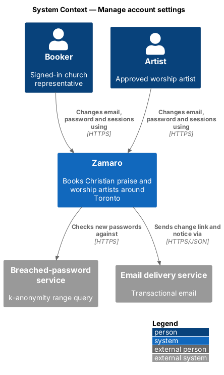
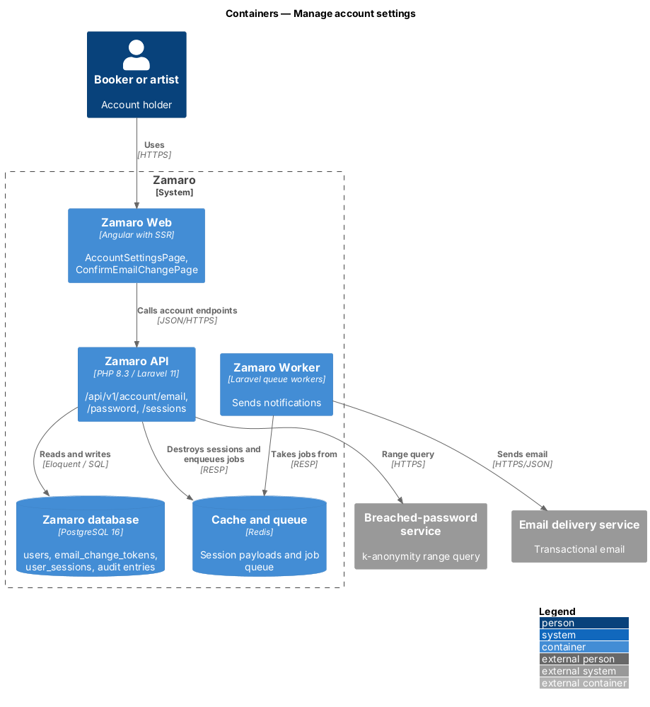
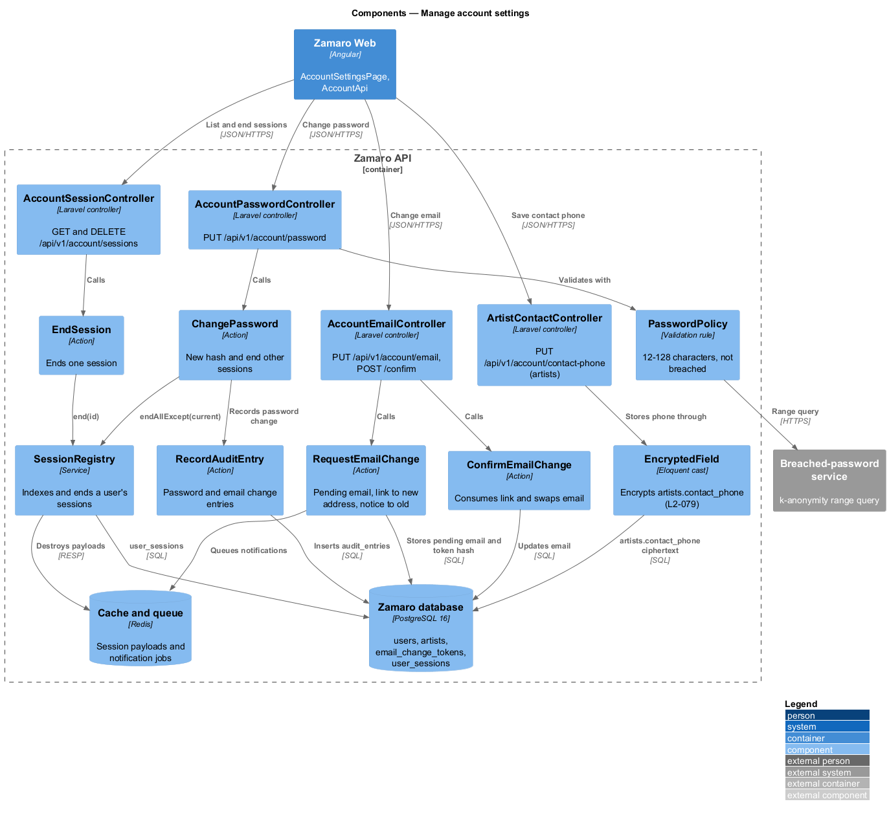
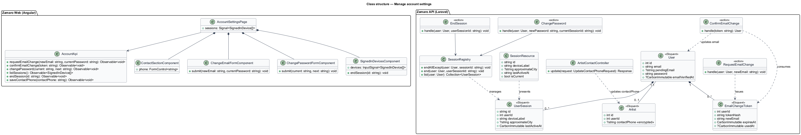
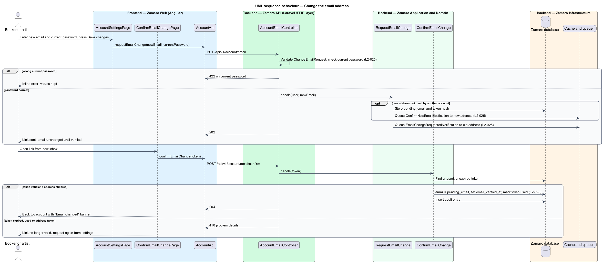
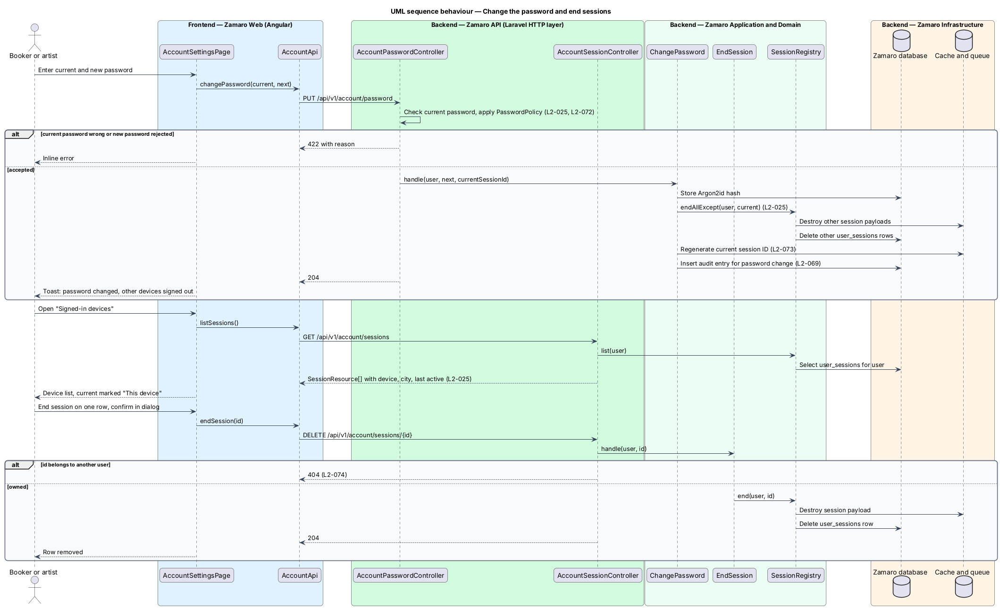

# Manage account settings

## Overview

Bookers and artists keep their own sign-in details current from one settings page.
This feature covers the changes L2-025 names: changing the account email,
changing the password while signed in, reviewing and ending the sessions listed
under "Signed-in devices", and an artist's private contact phone.

The slice runs from the account settings page in Zamaro Web to the account endpoints
in the Zamaro API. It builds on `accounts/sign-in-and-recover-access`, which defines
`PasswordPolicy` and `SessionRegistry`. The same page also hosts entry points owned
by other slices: the church (`accounts/manage-church-profile`), email preferences
(`notifications/manage-email-preferences`), two-step sign-in
(`accounts/sign-in-and-recover-access`), "Download my data"
(`privacy/export-personal-data`) and "Delete my account" (`privacy/delete-account`).

Terms used in this design:

- **account email** — verified address used for sign-in and all notifications
- **pending email** — new address that has been requested but not yet verified; the account email stays unchanged until it is
- **email change link** — single-use emailed link sent to the pending email that completes the change
- **re-authentication** — confirmation of the current password before a sensitive change
- **signed-in device** — one active session, described by device, approximate city and last-active time
- **current session** — the session making the request; it survives a password change while every other session ends
- **artist contact phone** — private North American phone an artist saves in the Contact section; never public, shown only to the booker of a Confirmed booking with the artist's account email (L2-046)

The email address only changes once the new address is proven (L2-025). A password
change ends every other session, so a device left signed in elsewhere is signed out.
An artist cannot accept a booking request until a contact phone is saved.

## Description

**Frontend (Zamaro Web, `features/account`)**

- **`AccountSettingsPage`** — routed page for `/account`, one page with a
  design-system settings navigation and these sections in order: Profile (`#profile`,
  the person's name), Church (`#church`, bookers) or Contact (`#contact`, artists),
  Email (`#email`), Password (`#password`),
  Email preferences (`#preferences`), Two-step sign-in (`#two-step`), Signed-in
  devices (`#devices`), Your data (`#data`) and Delete account (`#delete`). The
  Church section appears for bookers only; artists reach the same page from their
  account menu and see the Contact section in its place. The sections from Profile to Email preferences form one
  form with a sticky save bar: Save changes sends each changed section to its own
  endpoint, Discard resets them, and an invalid or failed save keeps every value with
  an error summary (L2-108). After a save a dismissible "Saved" banner confirms it.
  Two-step sign-in, devices, data and delete act at once from their own buttons.
- **`ChangeEmailFormComponent`** — new email and current password. On success it
  shows that a link was sent to the new address and that the account email stays the
  same until the link is opened.
- **`ChangePasswordFormComponent`** — current password and new password. It shows
  `PasswordPolicy` reasons inline (L2-072), and its section says that a new password
  signs out every other device.
- **`SignedInDevicesComponent`** — list of sessions with device label, approximate
  city and last-active time formatted through `FormatService` (L2-110). The current
  session is marked "This device". Every other row has an End session button that
  signs that device out at once, without a confirmation step.
- **`ConfirmEmailChangePage`** — routed page for `/account/email/confirm` that posts
  the token from the email change link. On success it returns to `/account` with an
  "Email changed" banner; a used or expired link says so and leaves the email
  unchanged.
- **`ContactSectionComponent`** — artists only. One required "Contact phone" field, validated
  as a North American number, with the help text "Churches see it only once a
  booking is confirmed. It's never on your public profile." It is saved through
  `PUT /api/v1/account/contact-phone` on `ArtistContactController` (L2-025). The
  "Add your contact phone before you accept." message of
  `bookings/respond-to-booking-request` links here (`/account#contact`).
- **Profile name** — the Profile section's name is saved through
  `PUT /api/v1/account/profile` on `AccountProfileController`, which validates it as
  required text.
- **`AccountApi`** — typed client for the account endpoints below.

**Mock screens** — the page is
[`pages/account`](../../../mocks/pages/account/default.html) in states default,
loading, error, [`invalid`](../../../mocks/pages/account/invalid.html), submitting,
[`success`](../../../mocks/pages/account/success.html) and
[`failed`](../../../mocks/pages/account/failed.html); an artist's page, without the
Church section and with the Contact section and Abigail's phone, is the
[`artist`](../../../mocks/pages/account/artist.html) state, and
the two-step section once it is on is the
[`two-step-on`](../../../mocks/pages/account/two-step-on.html) state. A
confirmed email change returns here with a success banner reading "Email changed. You
now sign in with {address}." The email change link lands on
[`pages/confirm-email`](../../../mocks/pages/confirm-email/default.html) in states
default, [`expired`](../../../mocks/pages/confirm-email/expired.html) and error.

**Backend (Zamaro API)**

- **`AccountEmailController`** — `PUT /api/v1/account/email` to request a change and
  `POST /api/v1/account/email/confirm` to complete it.
- **`ChangeEmailRequest`** — FormRequest that validates the new email format and
  checks `current_password` against the stored hash.
- **`RequestEmailChange`** — action that stores `pending_email` and a hashed
  `EmailChangeToken`, queues `ConfirmNewEmailNotification` to the new address, and
  queues `EmailChangeRequestedNotification` to the current address (L2-025). If the
  new address already belongs to another account, the response is unchanged and no
  link is sent, so the form does not reveal registered addresses.
- **`ConfirmEmailChange`** — action that consumes the token once, re-checks that the
  pending address is still free, moves `pending_email` into `email`, sets
  `email_verified_at`, and writes an audit entry.
- **`AccountPasswordController`** — `PUT /api/v1/account/password`.
- **`ChangePasswordRequest`** — FormRequest that checks `current_password` and applies
  `PasswordPolicy` to the new password (L2-072).
- **`ChangePassword`** — action that stores the new Argon2id hash, calls
  `SessionRegistry::endAllExcept` with the current session, regenerates the current
  session ID, and records the password change through `RecordAuditEntry` (L2-069).
- **`AccountSessionController`** — `GET /api/v1/account/sessions` and
  `DELETE /api/v1/account/sessions/{id}`. A session ID belonging to another user
  returns 404 (L2-074).
- **`EndSession`** — action that destroys the session payload in Redis and deletes
  its `user_sessions` row.
- **`SessionResource`** — serialises `id`, `deviceLabel`, `approximateCity`,
  `lastActiveAt` and `isCurrent`. It never exposes the session ID itself or the full
  IP address.
- **`ArtistContactController`** — `PUT /api/v1/account/contact-phone`, for users with
  the Artist role only; a booker receives `403`. `UpdateContactPhoneRequest`
  validates `contactPhone` as a North American number and the controller stores it
  in E.164 form on the signed-in artist's `Artist` row. The phone never appears in a
  public resource (`privacy/minimise-public-exposure`); `BookingResource` adds it to
  the contact card only for the booker of a Confirmed or Completed booking
  (`bookings/exchange-booking-messages`).
- **`TrackSessionActivity`** — middleware that updates `user_sessions.last_active_at`
  at most once per `<TO SUPPLY>` minutes, so activity tracking does not write on
  every request.

**Data**

- `users` — `email`, `pending_email`, `password`.
- `artists` — `contact_phone`, nullable, encrypted at the application level by the
  `EncryptedField` cast (L2-079, `security/protect-secrets-and-data`).
- `email_change_tokens` — `user_id`, `token_hash`, `new_email`, `expires_at`,
  `used_at`.
- `user_sessions` — defined in `accounts/sign-in-and-recover-access`.

The device label is derived from the user-agent string. The approximate city comes
from an IP geolocation lookup whose source is `<TO SUPPLY>`. The lifetime of an email
change link is `<TO SUPPLY>`.

**As built in M2 (S9)**

- **Page:** `pages/account/Account` at `/account`, rendered in the browser only (`RenderMode.Client`,
  ADR-0017) behind `signedInGuard`, which waits for `/me` and sends a guest to
  `/sign-in?returnUrl=/account`. The head reads "Account settings" over "Naomi Fraser · Riverside
  Community Church" ("Abigail Mensah · Artist" for an artist). `zm-settings-nav` ("Settings sections")
  lists the sections built so far; one reactive form holds Profile ("Your name", help "Artists see it on
  your requests." or, for an artist, "Your account name. Churches see the display name from Edit
  profile.") and Church or Contact, with `zm-form-actions` (Discard, Save changes).
- **Saving:** Save changes checks the sections it will send, then sends each one: the name when it
  changed (`PUT /api/v1/account/profile`, `AccountProfileController`, answering `CurrentUserResource`,
  so the initials follow), the church when it was saved before or typed into, the contact phone when it
  was saved before or typed into. While saving the bar reads "Saving…", fields are read-only and
  Discard is disabled; after it "Saved just now" and a dismissible "Saved" banner ("Your settings are
  up to date. Bookings already sent keep the church address they were made with."). A failure keeps
  every value: "We couldn’t save your changes" and "Not saved · try again". Invalid fields get a
  summary ("Fix 1 thing before saving") and "1 field to fix · not saved". A failed load shows "We
  couldn’t load your settings" with Try again and Back to Discover.
- **Contact phone:** `GET` and `PUT /api/v1/account/contact-phone` (`role:artist`; a booker gets 404,
  not the design's 403, per L2-074.1) answer `{ data: { contactPhone } }`; the phone is stored in E.164,
  encrypted (ADR-0020), and never on the public profile.
- **Status line:** empty until something is saved. The mock's "Saved 2 min ago" needs a saved time the
  frozen e2e clock cannot give.
- **Not yet:** Two-step sign-in (S12), Email
  preferences (S14); Your data and Delete account wait for M9 (M2 D23). The loading state announces
  "Loading your settings…" without the skeleton sections until `zm-form-section-skeleton` is built.

**As built in M2 (S10)**

- **Change email:** `PUT /api/v1/account/email` (`AccountEmailController@update`, `ChangeEmailRequest`:
  a full address other than the current one, and `currentPassword`, refused with "That password isn’t
  right. Check it and try again.") runs `RequestEmailChange` and answers 202 `{ data: { email } }`.
  Earlier links are used up; the new address gets `ConfirmNewEmailNotification` ("Confirm your new email
  for Zamaro", a `{web}/account/email/confirm?token=…` link that works once, for 24 hours, M2 D11) and the
  current one `EmailChangeRequestedNotification` ("Your Zamaro email is changing", with a reset link).
  An address another account uses gets the same answer and notice, but no link and no pending address.
  `users.pending_email` holds the new address, which `/me` returns as `pendingEmail`.
- **Confirm:** `POST /api/v1/account/email/confirm` is public (the token is the proof; it signs no one
  in), limited like the reset endpoints (30 a minute per address). `ConfirmEmailChange` moves the account
  once, within 24 hours, while the address is still free: `email` changes, verified, `pending_email`
  clears, and `account.email_changed` is audited. Otherwise the 410 `link-expired` names the address the
  account still signs in with when the link existed.
- **Change password:** `PUT /api/v1/account/password` (`AccountPasswordController`,
  `ChangePasswordRequest` with `currentPassword`, `PasswordPolicy` and the confirmation) runs
  `ChangePassword`: the hash changes, `auth.password_changed` is audited, `PasswordChangedNotification`
  is queued, `SessionRegistry::endAll` ends every session, and this one is regenerated (new ID and CSRF
  token) and registered again. It answers 204.
- **Page:** the Email section ("You sign in with {email}. …", New email, Current password with "Needed to
  change your email.") and the Password section ("Leave these empty to keep your password. A new one signs
  you out on your other devices.", Current password, New password with "12 to 128 characters. We check it
  against known leaked passwords.") join the form; Save changes sends them after Profile and Church or
  Contact, and empties their fields once sent. After a request the Email section's status line reads "We
  sent a link to {new}. You sign in with {current} until you open it." The page sends the new password as
  its own confirmation: the form has one field, as in the mock.
- **Confirm page:** `pages/confirm-email/ConfirmEmail` at `/account/email/confirm` (client-rendered):
  "Confirming your new email" (busy) with "Switching your sign-in to {new}…" and "Until this finishes you
  still sign in with {current}." when signed in, "We couldn’t confirm your new email" with Try again and
  Back to account settings, and "This link has expired" with the stamp, "Nothing changed: you still sign
  in with {email}. …" and "Change email again" (`/account#email`). On success it goes to `/account`, where
  the shell shows "Email changed" with "You now sign in with {email}." for one page.

**As built in M2 (S11)**

- **Endpoints:** `GET /api/v1/account/sessions` (`AccountSessionController@index`) answers
  `SessionResource`s for the sessions whose last activity is within the idle lifetime: this browser's
  first, then the most recently active. `id` is the registry key (the SHA-256 of the session ID), never
  the ID itself; no IP address is returned. `DELETE /api/v1/account/sessions/{id}` ends one at once
  (204; its payload is destroyed, so its next request gets 401); a key that is not the caller's is the
  same 404 as an unknown one (L2-074.2).
- **Registry:** `SessionRegistry::register` stores the device label (`App\Support\DeviceLabel`: "Chrome
  on Windows", "Safari on iPhone", "Firefox on Mac", "Edge on Windows", "Chrome on Android", "Safari on
  iPad", "Chrome on Linux", else "Unknown device") and the approximate city from the `IpLocator` port
  (M2 D13: `FakeIpLocator` places loopback, 172.16/12 and 192.168/16 in Burlington, 10/8 in Hamilton,
  anything else nowhere). `TrackSessionActivity` runs on every `api.php` route and moves
  `last_active_at` at most every 5 minutes (M2 D12). Times in queries keep their offset.
- **Page:** the Signed-in devices section follows the form (it acts at once, outside the save bar):
  `zm-list variant="device"`, this device first with "{city} · This device · active now" and the "This
  device" badge, the others with "{city} · Last active {just now | n min ago | n hours ago | Tue 6 Oct}"
  (`FormatService.ago`) and "End session" (named "End session on {device}"), which removes the row with
  no confirmation. The help line reads "Cities are approximate, from each device’s network. Ending a
  session signs that device out at once." The Password lead counts the others: "…your other device." or
  "…your other 2 devices."; a password change reloads the list.

**As built in M2 (S14):** the Email preferences section joins the form after Password: "Email me
about", "Bookings and payments" ("Requests, bookings and payouts" for an artist), always on and disabled,
and for a booker "New artists near my church", which Save changes sends as a marketing record
(`privacy/record-consent`). The event reminder and review prompt boxes wait for M7 (M2 D23). `/account`
and the setup page are behind `termsGuard`.

## Requirements

The feature realises the following level-2 (L2) requirement, quoted from
`docs/specs/L2.md`.

| L2 ID | Refines (L1) | Requirement |
|-------|--------------|-------------|
| `L2-025` | `L1-004` | **Account settings.** Acceptance criteria: 1. Given a signed-in user changes their email, when they confirm with their current password, then a verification link goes to the new address and the email changes only after it is verified; the old address receives a notice. 2. Given a signed-in user changes their password, when they provide the correct current password, then the password is updated and all other sessions end. 3. Given a signed-in user, when they open "Signed-in devices", then they see each active session's device, approximate city and last-active time and can end any of them. 4. Given a signed-in artist, when they save a contact phone (valid North American number) in the Contact section of account settings, then it is stored as their private contact phone; it is required before they can accept a booking request, is never shown on their public profile, and is shown only to the booker of a Confirmed booking with the artist's account email (L2-046). |

## Diagrams

### System context

A booker or artist changes sign-in details in Zamaro. Zamaro checks new passwords
against the breached-password service and sends the email change link and notice
through the email delivery service.

### Containers

The settings page in Zamaro Web calls the account endpoints in the Zamaro API. The
API updates the database, ends sessions in Redis, and queues emails for the Zamaro
Worker.

### Components

Four controllers front four actions. `ChangePassword` and `EndSession` both work
through `SessionRegistry`, and `ArtistContactController` saves the artist's
encrypted contact phone.

### Class structure

A `User` owns `EmailChangeToken` rows and `UserSession` rows, and an artist's
`Artist` row holds the encrypted contact phone. `SessionResource` presents each
`UserSession` without exposing the session identifier.

### Behaviour — change the email address

The change is confirmed with the current password, and the account email changes
only when the link sent to the new address is opened. The old address receives a
notice.

### Behaviour — change the password and end sessions

A password change with the correct current password ends every other session. A
single session can also be ended from the signed-in devices list.

