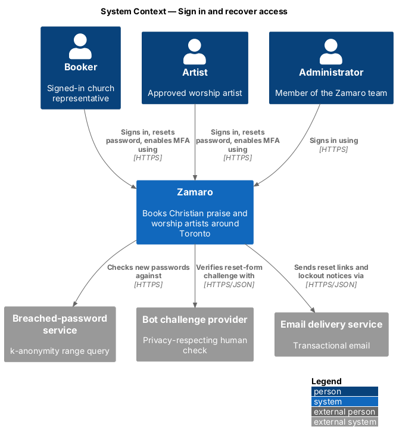
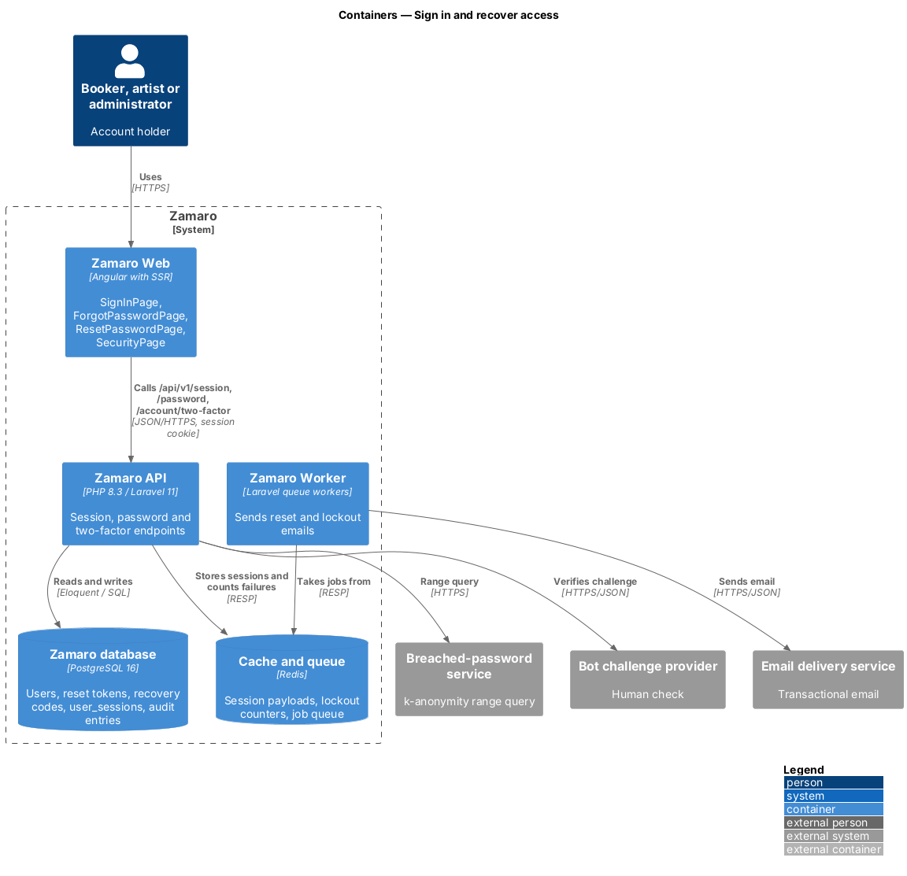
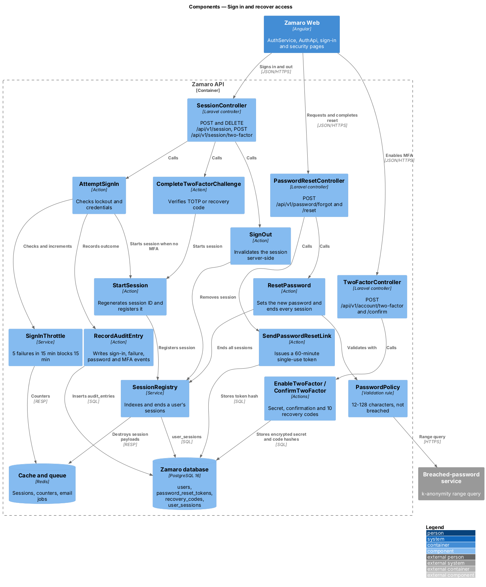
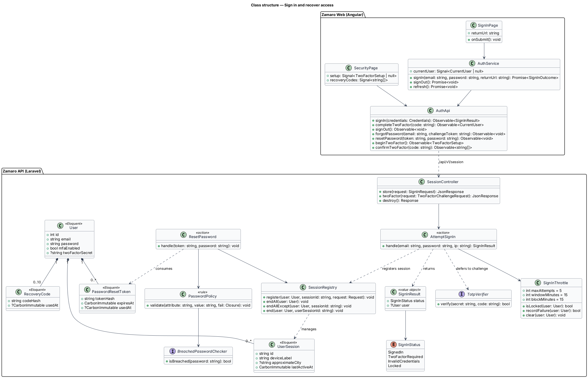
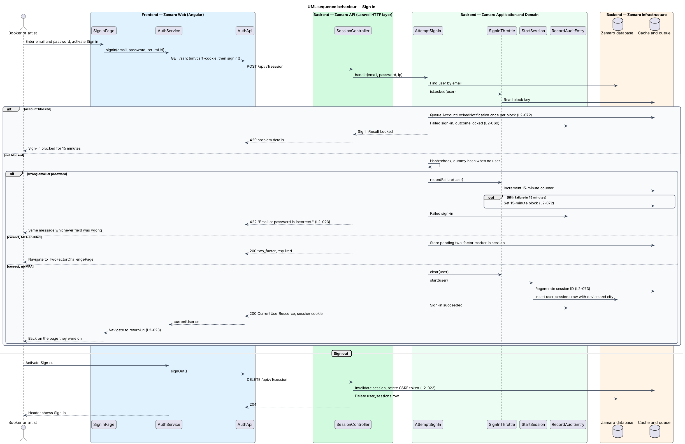
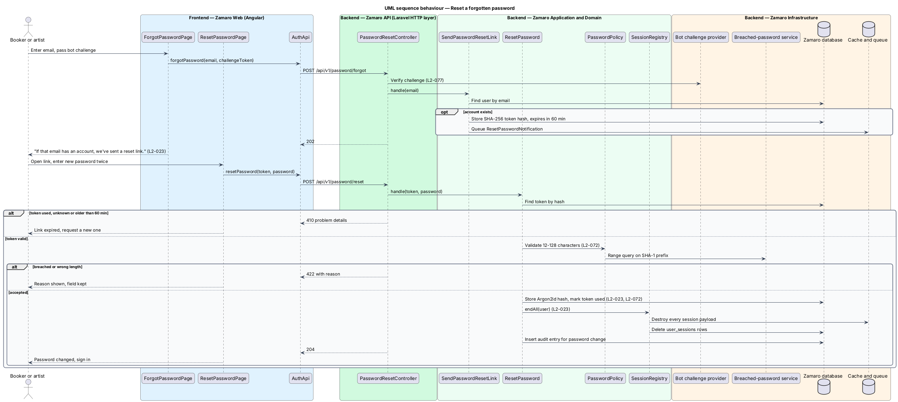
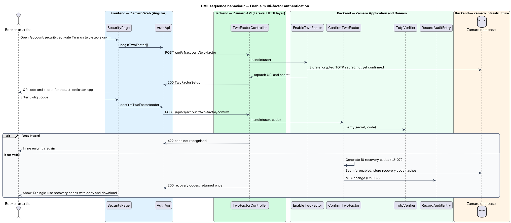

# Sign in and recover access

## Overview

Bookers, artists and administrators reach their private areas of Zamaro through one
sign-in. This feature covers starting and ending a session, recovering access with a
password reset, and the account protections that sit around those steps: the
password policy, password hashing, lockout after repeated failures, and optional
time-based one-time password (TOTP) multi-factor authentication.

The slice runs from the sign-in, reset and two-step sign-in pages in Zamaro Web to the
session, password and two-factor endpoints in the Zamaro API, with session state in
Redis and accounts in the Zamaro database. Registration is a sibling slice
(`accounts/register-booker`) that applies the same `PasswordPolicy`. Changing a
password while signed in, changing email and the "Signed-in devices" list live in
`accounts/manage-account-settings`, which reuses the `SessionRegistry` defined here.
Acceptance of updated terms at sign-in belongs to `privacy/record-consent`.

Terms used in this design:

- **session** — server-side record in Redis, identified by an `HttpOnly` cookie, that keeps a user signed in
- **session registry** — per-user index of active sessions, used to end every session but one
- **lockout** — 15-minute block on sign-in for one account after 5 failed attempts within 15 minutes
- **password reset link** — single-use emailed link that lets the owner set a new password, valid for 60 minutes
- **breached password** — password that appears in the breached-password service's corpus
- **k-anonymity range query** — lookup that sends only the first 5 hex characters of the password's SHA-1 hash and compares the returned suffixes locally
- **TOTP** — time-based one-time password from an authenticator app, as defined in RFC 6238
- **recovery code** — single-use code, issued in a set of 10, that substitutes for a TOTP code when the authenticator is lost
- **return URL** — path of the page the user was on before signing in

Sign-in never says which of email or password was wrong (L2-023). Password reset
never says whether an email has an account. A successful reset ends every other
session, so a stolen session cannot outlive a recovered account.

## Description

**Frontend (Zamaro Web, `features/account`)**

- **`SignInPage`** — routed page for `/sign-in`. It holds email and password fields,
  reads the `returnUrl` query parameter set by `authGuard`, and on success navigates
  back to it (L2-023). It shows "Email or password is incorrect." for any credential
  failure. When sign-in is blocked it shows "Sign-in is paused for 15 minutes" with
  the time it ends and a link to reset the password, in the same words whether or not
  the email has an account. When `SessionExpiredInterceptor`
  (`security/manage-sessions-and-csrf`) sends the user here it shows "Your session
  ended" above the form.
- **`MfaChallengePage`** — routed page for `/account/sign-in/verify`, shared with
  administrators (`administration/secure-admin-access`). It accepts a 6-digit TOTP
  code or, after "Use a recovery code instead", a recovery code.
- **`ForgotPasswordPage`** — routed page for `/forgot-password` with an email field
  and the bot challenge widget (L2-077). It always shows "If that email has an
  account, we've sent a reset link."
- **`ResetPasswordPage`** — routed page for `/reset-password/:token` that checks the
  token through the check endpoint (showing a skeleton form meanwhile), then asks for
  the new password twice; a used or expired token shows "This link has expired" with
  Send a new link. On success the person is signed in on
  this device only, and every other session has ended (L2-023).
- **Two-step sign-in section** — section `#two-step` of `AccountSettingsPage`
  (`accounts/manage-account-settings`). It shows whether two-step sign-in is on. When
  off, its Turn on button navigates to `MfaEnrolmentPage`; when on, it offers Turn off
  and New recovery codes, and each opens `TwoStepCodeDialogComponent` (L2-072).
- **`TwoStepCodeDialogComponent`** — CDK dialog that asks for a current TOTP code or
  an unused recovery code before turning two-step sign-in off or issuing new
  recovery codes. Turning off is a destructive dialog with "Keep it on" first; new
  codes are shown once in the dialog with copy and download actions, and replace
  every earlier code (L2-072). A wrong code is shown inline and counts toward the
  lockout like a wrong code at sign-in.
- **`MfaEnrolmentPage`** — routed page for `/account/security/mfa`, also used to
  enrol administrators. It starts enrolment, shows the QR code and secret, confirms
  with a code, and shows the 10 recovery codes once with copy and download actions
  (L2-072).
- **`AuthService`** — shared service holding `currentUser` as a signal. It exposes
  `signIn`, `signOut` and `refresh`. After sign-out the header shows Sign in.
- **`authGuard`** — route guard for private routes that redirects a guest to
  `/sign-in?returnUrl=…`.
- **`AuthApi`** — typed client for the session, password and two-factor endpoints.
  It calls `GET /api/v1/csrf-cookie` before the first state-changing request.

**Mock screens** — sign-in is
[`pages/sign-in`](../../../mocks/pages/sign-in/default.html) in states default,
[`invalid`](../../../mocks/pages/sign-in/invalid.html), submitting, error,
[`expired`](../../../mocks/pages/sign-in/expired.html) (session ended) and
[`locked`](../../../mocks/pages/sign-in/locked.html). The code step is
[`pages/mfa-challenge`](../../../mocks/pages/mfa-challenge/default.html) in states
default, [`recovery`](../../../mocks/pages/mfa-challenge/recovery.html), invalid,
submitting, error and [`locked`](../../../mocks/pages/mfa-challenge/locked.html), the
same pause as the password step. Recovery is
[`pages/forgot-password`](../../../mocks/pages/forgot-password/default.html) and
[`pages/reset-password`](../../../mocks/pages/reset-password/default.html), including
its [`loading`](../../../mocks/pages/reset-password/loading.html) (token check),
[`expired`](../../../mocks/pages/reset-password/expired.html) and
[`success`](../../../mocks/pages/reset-password/success.html) states. Enrolment is
[`pages/mfa-setup`](../../../mocks/pages/mfa-setup/default.html) in states default,
loading, [`invalid`](../../../mocks/pages/mfa-setup/invalid.html), submitting, error
and [`codes`](../../../mocks/pages/mfa-setup/codes.html), opened from the
[two-step section of account settings](../../../mocks/pages/account/default.html), for
artists [the same section](../../../mocks/pages/account/artist.html). Once it is on, the
section is [`pages/account/two-step-on`](../../../mocks/pages/account/two-step-on.html),
and Turn off and New recovery codes open
[`dialogs/two-step-code`](../../../mocks/dialogs/two-step-code/default.html) in states
default (turn off), [`invalid`](../../../mocks/dialogs/two-step-code/invalid.html), busy,
[`failed`](../../../mocks/dialogs/two-step-code/failed.html),
[`new-codes`](../../../mocks/dialogs/two-step-code/new-codes.html) and
[`codes`](../../../mocks/dialogs/two-step-code/codes.html).

**Backend (Zamaro API)**

- **`SessionController`** — `POST /api/v1/session` (sign in),
  `POST /api/v1/session/two-factor` (complete a challenge) and
  `DELETE /api/v1/session` (sign out).
- **`SignInRequest`** — FormRequest that validates email and password presence.
- **`AttemptSignIn`** — action that asks `SignInThrottle` whether the account is
  locked, checks the password with `Hash::check` (against a dummy hash when no user
  matches, so timing does not reveal existence), and on success either starts the
  session or, when `mfaEnabled` is true or the user is an administrator (for whom
  MFA is mandatory), stores a pending-challenge marker and returns
  `two_factor_required`. Each outcome writes an audit entry through
  `RecordAuditEntry` (L2-069).
- **`SignInThrottle`** — Redis counter keyed on the normalised email address, so an
  address without an account is paused the same way and the response reveals
  nothing. The fifth failure within 15 minutes sets a 15-minute block. The next
  attempt is refused and, when the address has an account, queues
  `AccountLockedNotification` to the owner, once per block (L2-072).
- **`CompleteTwoFactorChallenge`** — action that verifies a TOTP code with
  `TotpVerifier` or consumes one hashed recovery code, then starts the session. A
  wrong code is recorded as a failed sign-in in `SignInThrottle`, so wrong codes and
  wrong passwords share the 5-in-15-minutes lockout, and a blocked account's
  challenge is refused like its password step (L2-072).
- **`StartSession`** — regenerates the session ID (L2-073), registers it in
  `SessionRegistry`, and returns `CurrentUserResource`.
- **`SignOut`** — action that invalidates the session in Redis, removes it from
  `SessionRegistry` and rotates the CSRF token (L2-023).
- **`PasswordResetController`** — `POST /api/v1/password/forgot`, behind the bot
  challenge (`security/limit-request-rates`); `POST /api/v1/password/reset/check`,
  which tells `ResetPasswordPage` whether a token is still usable without consuming
  it; and `POST /api/v1/password/reset`. All three are rate-limited.
- **`SendPasswordResetLink`** — action that, when the email matches a user, stores a
  SHA-256 hash of a random token with a 60-minute expiry in `password_reset_tokens`
  and queues `ResetPasswordNotification`. The response is identical either way.
- **`ResetPassword`** — action that consumes the token once, applies
  `PasswordPolicy`, stores the new hash, ends every session through
  `SessionRegistry::endAll`, writes an audit entry and queues
  `PasswordChangedNotification` to the account email. It then starts a fresh session
  for this browser through `StartSession`, or the two-factor challenge when MFA is
  enabled.
- **`PasswordPolicy`** — validation rule shared with registration and account
  settings. It enforces 12–128 characters and asks `BreachedPasswordChecker` whether
  the password is breached, returning the reason for any rejection (L2-072).
- **`BreachedPasswordChecker`** — interface with one adapter for the
  breached-password service using a k-anonymity range query.
- **`SessionRegistry`** — service backed by the `user_sessions` table. It records
  each session's device, approximate city and last-active time, and ends one, all, or
  all but the current session.
- **`TwoFactorController`** — `POST /api/v1/account/two-factor` (begin),
  `POST /api/v1/account/two-factor/confirm`, `DELETE /api/v1/account/two-factor`
  (turn off) and `POST /api/v1/account/two-factor/recovery-codes` (new codes).
- **`EnableTwoFactor`** — action that generates a TOTP secret, stores it encrypted,
  and returns an `otpauth://` URI. **`ConfirmTwoFactor`** verifies the first code,
  sets `mfaEnabled`, generates 10 recovery codes, stores their hashes and returns the
  plain codes once. **`DisableTwoFactor`** and **`RegenerateRecoveryCodes`** first
  verify a current TOTP code or consume an unused recovery code; the first clears the
  secret and every recovery code and is refused for administrators, and the second
  replaces all 10 codes and returns the new ones once (L2-072). Each writes an audit
  entry for the MFA change.

Passwords are hashed with Argon2id through Laravel's hasher (L2-072). Password
fields are excluded from request logging by the log redaction rules (L2-079). Lockout
emails and reset emails are queued notifications processed by the Zamaro Worker.

**Data**

- `users` — `password`, `mfa_enabled`, `two_factor_secret` (encrypted),
  `two_factor_confirmed_at`.
- `recovery_codes` — `user_id`, `code_hash`, `used_at`.
- `password_reset_tokens` — `user_id`, `token_hash`, `expires_at`, `used_at`.
- `user_sessions` — `id` (hash of the session ID), `user_id`, `device_label`,
  `approximate_city`, `ip_address`, `last_active_at`.
- Redis — session payloads and `SignInThrottle` counters.

TOTP codes from one 30-second step either side are accepted for clock drift, and MFA
is mandatory for administrators (`administration/secure-admin-access`). The TOTP
library is `<TO SUPPLY>`. The breached-password service vendor is `<TO SUPPLY>`.

**As built in M2 (S1, sign in)**

- **Layout (ADR-0007, ADR-0016):** the page is `pages/sign-in/SignIn` in the zamaro application. The
  card is the library's `zm-booking-form variant="auth"` (booking-form CRD; the plan's "`zm-auth-card`"
  is its `AuthCard` perf scenario), with `zm-form-field`s, `zm-error-summary` and a compact `zm-alert`.
  `AuthService` (the `currentUser` signal), the `AuthApi` contract behind `AUTH_API`, `withApiXsrf()`
  and `safeReturnUrl()` live in `api/lib/auth/`. A `returnUrl` that is not a path on the site (another
  host, `//host`) is ignored and the person lands on Discover.
- **Endpoint:** `POST /api/v1/session` (`SessionController@store`, `SignInRequest`, `AttemptSignIn`,
  `StartSession`) answers 200 with `CurrentUserResource` and `Cache-Control: private, no-store`
  (`SetCachePolicy`, L2-089.3). Wrong credentials are 422 with `errors.credentials`: ["Email or password
  is incorrect."] (M2 D10); an empty field is an ordinary 422 on `email` or `password`, which the page
  shows with the same one message. Emails match whatever their case or surrounding spaces. An unknown
  email is checked against a dummy hash made with the current cost and cached.
- **Hashing (M2 D1):** `config/hashing.php` sets Argon2id with Laravel's defaults (65,536 KiB, 4
  passes, 1 thread); the test suite lowers it to 1,024 KiB and 1 pass.
- **Audit (M2 D22):** `RecordAuditEntry` writes `auth.sign_in` (succeeded) and `auth.sign_in_failed`
  (failed; no actor for an unknown email, the attempted email in `context`) to the append-only
  `audit_entries` table, whose trigger refuses `UPDATE` and `DELETE`.
- **Page states:** default, invalid (summary "Couldn’t sign you in", both fields invalid and described
  by `#credentials-error`, password cleared, focus on the summary), submitting ("Signing in…", fields
  read-only and faded) and error ("We couldn’t sign you in"). The error state keeps the password as
  well as the email, as L2-108.3 requires, although the mock shows it empty; focus moves to the
  password. Focus starts in Email.
- **Not yet:** the card's "Forgot your password?" and "Create an account" links join when those pages
  exist (S8, S5); the lockout is S8 and two-step sign-in S12.

**As built in M2 (S2, signed-in header and sign-out)**

- **Endpoint:** `DELETE /api/v1/session` (`SessionController@destroy`, in `routes/api.php` behind
  `auth:sanctum`) runs `SignOut`: the web guard logs out, the session is invalidated and the CSRF
  token regenerated, and the answer is 204 with `Cache-Control: private, no-store`. The cookie the
  browser held then gets 401 from `/me`; a guest gets the 401 problem. `SessionRegistry` joins
  `SignOut` with S8, and sign-out is not audited (the design lists no entry for it).
- **Header and footer (ADR-0017):** the server renders every page signed out. In the browser the shell
  calls `AuthService.load()` after the first render; once `/me` answers, the top bar shows the
  `zm-avatar-button` "NF", named "Account menu for Naomi Fraser", and the footer's last column is
  headed with her name (her church joins in S9, "Saved artists (3)" in S15). Guests see "Sign in" in
  the header, carrying the page as `returnUrl` (top-bar D-14), and a "Your account" footer column
  with "Sign in". On `/sign-in` the header has no auth link until "Create account" can go to
  `/sign-up` (S5).
- **Account menu:** `dialogs/account-menu/AccountMenuDialog`, a CDK dialog (`zm-dialog
  variant="menu"`, transparent backdrop) under the top bar's right edge. It lists her name and email
  in the who header (the dialog's description), Account settings (`/account`, built in S9), a
  separator and Sign out; focus starts on the first item and returns to the avatar. "Your bookings"
  waits for M5 and "Saved artists" for S17 (M2 D23).
- **Sign out:** `AuthService.signOut()` calls `DELETE /api/v1/session`, treats a 401 (the session had
  already ended) as signed out, clears `currentUser` and dismisses every toast; the header then shows
  "Sign in".

**As built in M2 (S3):** the `expired` state ("Your session ended", `?ended=1`) is built as the sessions
design describes; see `security/manage-sessions-and-csrf`.

**As built in M2 (S8, lockout and password reset)**

- **Lockout:** `SignInThrottle` counts failures in the cache (Redis) by the SHA-256 of the address in
  lower case. The 5th failure within 15 minutes clears the count and stores the pause's end for 15
  minutes. `AttemptSignIn` asks first: while paused, every try (right password or not) is audited
  `auth.sign_in_failed` (denied, `reason: paused`) and refused with the 429 `sign-in-paused` problem
  ("Sign-in is paused for 15 minutes", `pausedUntil` in Toronto time, `Retry-After`). The first refusal
  of a pause queues `AccountLockedNotification` when the address has an account (a cache `add`, so once
  per pause). A successful sign-in clears the count.
- **Session registry:** `user_sessions` keys each row by the SHA-256 of the session ID and keeps the ID
  encrypted only so `endAll` can destroy its payload. `StartSession` registers, `SignOut` forgets.
  The device label and city columns are filled in S11.
- **Endpoints (all public, `Cache-Control: private, no-store`):** `POST /password/forgot` (bot
  challenge `forgot-password`, M2 D6: 5 an hour per address and per email typed) answers 202 `{ data:
  { email } }` for any address, and a new link marks the earlier ones used. `POST /password/reset/check`
  answers `{ data: { email, expiresAt } }` without using the link. `POST /password/reset` (both 30 a
  minute per address) uses it, applies `PasswordPolicy` and the confirmation, ends every session, audits
  `auth.password_reset`, queues `PasswordChangedNotification` and answers with `CurrentUserResource` for
  a new session in this browser. A used, run-out or unknown link is the 410 `link-expired` problem; one
  that existed adds `email` and `sentAt`, which the expired card shows. The two-factor branch joins in
  S12.
- **Pages:** `pages/forgot-password/ForgotPassword` (default, invalid, sending, challenge failed, error,
  "Check your email" with "Send it again") and `pages/reset-password/ResetPassword` at
  `/reset-password/:token` (checking, form, invalid, saving, error, "Password changed", expired with "Send
  a new link" when the link named its account). The sign-in card gains "Forgot your password?", and its
  paused state shows "Sign-in is paused for 15 minutes" with the end time, "Reset your password" and "If
  this wasn’t you, the account owner has been emailed." The duplicate sign-up email links to
  `/forgot-password`.
- **Times** in pages and emails read "10:57 a.m." (`FormatService.time`, `format.time`).

**As built in M2 (S12, two-step sign-in on, and signing in with a code)**

- **Library (ADR-0021):** `pragmarx/google2fa` behind `TotpVerifier` (one step either side, the real
  clock) and `bacon/bacon-qr-code` for the QR code, served as SVG from `GET
  /api/v1/account/two-factor/qr`. The TOTP library is no longer `<TO SUPPLY>`.
- **Turning on:** `POST /api/v1/account/two-factor` (`TwoFactorController@begin`, `EnableTwoFactor`)
  stores a new key with the field key and answers `{ key, otpauthUri }`, the key in groups of four; a
  second call replaces it, and with two-step sign-in already on it is the 409 `two-factor-already-on`.
  `POST …/two-factor/confirm` checks the first code ("That code didn’t match. Codes change every 30
  seconds; enter the one showing now."), sets `mfa_enabled` and `two_factor_confirmed_at`, replaces the
  10 recovery codes (`RecoveryCodes`: `xxxx-xxxx`, SHA-256, once each), audits
  `auth.two_factor_enabled` and queues `TwoStepSignInChangedNotification` ("Two-step sign-in is on for
  your Zamaro account", M2 D21), answering the codes once. `/me` gains `mfaEnabled`.
- **Signing in:** with the right password and two-step sign-in on, `POST /session` answers 202 `{
  twoFactorRequired, email }` and `TwoFactorChallenge` leaves a 10-minute marker in the session instead
  of signing in. `POST /api/v1/session/two-factor` (public, 30 a minute per address) takes `code` or
  `recoveryCode` (with or without the dash, any case): right, it signs in with a new session ID and
  audits `auth.sign_in`; wrong, 422 ("That code is wrong or has expired. Enter the code your app shows
  now." / "That recovery code is wrong or was used. Enter another of your saved codes.") and a failure
  for the lockout, which pauses codes and passwords alike (429 `sign-in-paused`); no marker or an old
  one, 401. A password reset leads to the same code step (202).
- **Pages:** `pages/mfa-setup/MfaSetup` at `/account/security/mfa` (guarded, client-rendered): loading,
  the QR code and key, the 6-digit code ("Turn on", "Checking…"), "Check the code", "We couldn’t turn
  on two-step sign-in", then "Save your recovery codes" with the codes as `zm-list variant="grid"
  ordered`, Download codes (a text file), Copy codes and "I’ve saved them". `pages/mfa-challenge/
  MfaChallenge` at `/account/sign-in/verify`: "Enter your code" with "Signing in as {email}." (passed
  on by the sign-in page), "Use a recovery code instead", "That code didn’t work", "We couldn’t check
  your code", the pause, and "Sign in as someone else"; success returns to the sign-in page's
  `returnUrl`. Account settings gains the Two-step sign-in section ("Off" or "On", "Turn on two-step
  sign-in"); turning off and new codes are S13.

**As built in M2 (S13, turning two-step sign-in off, and new recovery codes)**

- **Endpoints:** `DELETE /api/v1/account/two-factor` (204) and `POST
  /api/v1/account/two-factor/recovery-codes` (200, the 10 new codes once) both take `code`: a current
  6-digit code or an unused recovery code, which is used up. `ManageTwoFactor` (the design's
  `DisableTwoFactor` and `RegenerateRecoveryCodes`, as one action) refuses a wrong one with "That code
  is wrong or has expired. Enter the code your app shows now, or an unused recovery code." and counts it
  toward the sign-in pause (429 once paused). Turning off clears the key and every recovery code; new
  codes replace all ten. Each is audited (`auth.two_factor_disabled`, `auth.recovery_codes_replaced`) and
  emailed (M2 D21: "Two-step sign-in is off for your Zamaro account", "New recovery codes for your Zamaro
  account"). With two-step sign-in off, both are 404. The administrators' refusal joins with M3's admin
  role.
- **Dialog:** `dialogs/two-step-code/TwoStepCode`, a CDK dialog on `zm-dialog` (danger rule and
  `lock-open` icon to turn off, `key` icon for codes), described by "Enter a code to show it’s you.":
  the consequences or "You get 10 new codes. …", the Code field ("The 6 digits your app shows now, or one
  unused recovery code like 7kq4-m2xd."), "Keep it on" / "Cancel" before "Turn off" / "Get new codes";
  invalid ("Check the code", "That code didn’t work"), busy ("Turning off…", "Getting codes…", the way
  back and Escape held), failed (the alert, "Try again", focus on the way back) and, for codes, "Save
  your new recovery codes" with the grid list, Download, Copy and "I’ve saved them". Focus returns to
  the button that opened it. Account settings shows "On" with New recovery codes and Turn off.

## Requirements

The feature realises the following level-2 (L2) requirements, quoted from
`docs/specs/L2.md`.

| L2 ID | Refines (L1) | Requirement |
|-------|--------------|-------------|
| `L2-023` | `L1-004` | **Sign-in, sign-out and password reset.** Acceptance criteria: 1. Given valid credentials, when a user signs in, then a session starts and they return to the page they were on. 2. Given invalid credentials, when a user signs in, then the message is "Email or password is incorrect." regardless of which was wrong. 3. Given a password reset request, when it is submitted, then the response is always "If that email has an account, we've sent a reset link." and the link is single-use and expires after 60 minutes. 4. Given a successful password reset, when it completes, then every other session for that account is ended. 5. Given a signed-in user, when they sign out, then the session is invalidated server-side and the header shows Sign in. |
| `L2-072` | `L1-016` | **Passwords and multi-factor authentication.** Acceptance criteria: 1. Given a new password, when it is set, then it must be 12–128 characters and not appear in a known-breached password list (checked by k-anonymity range query), or it is rejected with the reason. 2. Given a password, when it is stored, then it is hashed with Argon2id or bcrypt (cost 12 or higher) and never logged or stored in plain text. 3. Given any booker or artist, when they open security settings, then they can enable TOTP multi-factor authentication and receive 10 single-use recovery codes. 4. Given 5 failed sign-ins for one account within 15 minutes, when a sixth is attempted, then sign-in for that account is blocked for 15 minutes and the owner is emailed. 5. Given a booker or artist with two-step sign-in on, when they turn it off or ask for new recovery codes in security settings, then a current authenticator code or an unused recovery code is required first, and new codes replace every earlier code; administrators cannot turn it off (L2-066). |

## Diagrams

### System context

Bookers, artists and administrators sign in to Zamaro. Zamaro checks new passwords
with the breached-password service, verifies the bot challenge on reset, and emails
reset links and lockout notices.

### Containers

Zamaro Web calls the session, password and two-factor endpoints in the Zamaro API.
The API keeps sessions and lockout counters in Redis and accounts in the database,
and the Zamaro Worker sends the emails.

### Components

`SessionController` delegates to `AttemptSignIn`, `CompleteTwoFactorChallenge` and
`SignOut`. `PasswordResetController` delegates to `SendPasswordResetLink` and
`ResetPassword`, which share `PasswordPolicy` and `SessionRegistry`.

### Class structure

A `User` owns its `RecoveryCode` rows, `PasswordResetToken` rows and `UserSession`
entries. `SignInResult` tells the frontend whether a session started, a two-factor
challenge is due or the account is locked.

### Behaviour — sign in

A locked account is refused before the password is checked. Wrong credentials count
toward the lockout and return one generic message. Correct credentials either start
the session or, with MFA enabled, lead to the two-factor challenge.

### Behaviour — reset a forgotten password

The forgot-password response is identical for every address. A valid, unused link
younger than 60 minutes sets the new password, ends every session for the account
and signs the person in on this device only.

### Behaviour — enable multi-factor authentication

Enrolment returns a secret for the authenticator app. The first valid code turns MFA
on and returns 10 single-use recovery codes, shown once.

