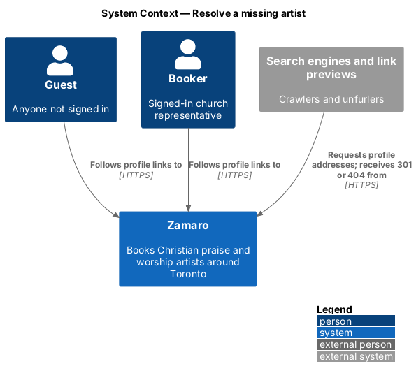
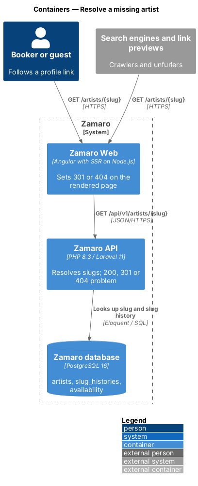
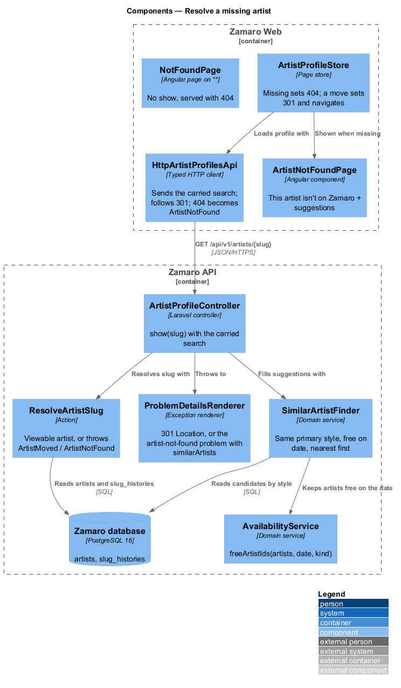
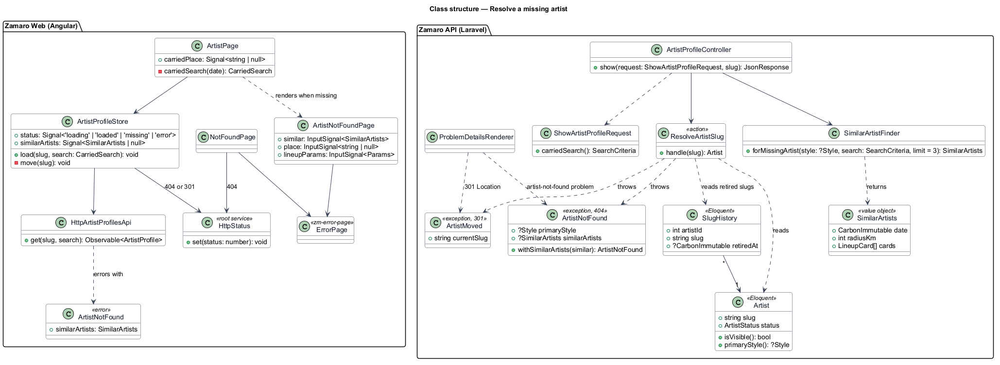
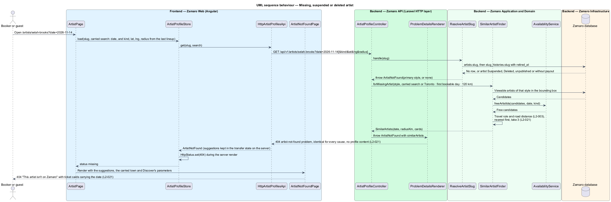
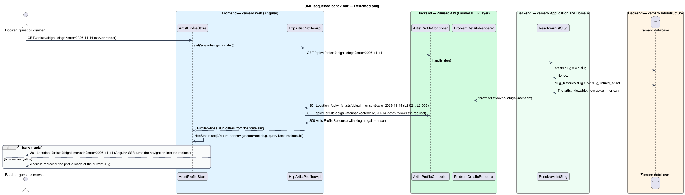

# Resolve a missing artist

## Overview

Profile links outlive the profiles they point to. A church may follow a link to an
artist who has left Zamaro or been suspended, or who has renamed their profile
address. A link may also hold a mistyped slug. In each case the page shall answer
truthfully without leaking anything about a hidden profile, and shall offer the church
a way to continue.

This feature decides what `/artists/{slug}` returns when the slug does not lead to a
viewable profile. It has two outcomes. The first is a 404 page that reads "This artist
isn't on Zamaro" and suggests up to 3 similar artists free on the carried date. The
second is a 301 redirect from a renamed slug to the current one. The normal profile
page belongs to `artist-profiles/view-artist-profile`. The rules for choosing and
changing a slug belong to `artist-workspace/change-profile-address` (L2-055).

Terms used in this design:

- **slug** — lowercase, hyphenated name segment that identifies an artist in the profile URL
- **viewable artist** — artist with status `Approved` and a published profile
- **hidden artist** — artist with status `Suspended` or `Deleted`, or whose profile is not published
- **slug history** — record of every slug an artist used before the current one, never reassigned to another artist
- **carried date** — search date passed to the profile in the `date` query parameter
- **carried search** — the Discover search the visitor came from: date, church location and radius, as kept in the Discover URL (`discovery/sort-and-filter-results`)
- **similar artist** — viewable artist who shares the missing artist's primary style, is free on the carried date and is within travel range of the carried search location

A hidden artist and a slug that never existed produce the same 404 status and the
same page, so a visitor cannot tell them apart (L2-021). A renamed slug redirects only
when the artist it leads to is viewable. Otherwise it also produces the 404.

## Description

Resolution happens once, in the Zamaro API. Zamaro Web then turns the API outcome
into the matching HTTP status for the server-rendered page.

The names, the slug-history columns and the open questions below were settled in
[ADR-0011](../../../adr/0011-slug-history-and-artist-slug-resolution.md) when M1 S15 built the
feature.

**Backend (Zamaro API)**

- **`ResolveArtistSlug`** (`Actions/ArtistProfiles`) — action shared by every
  `/api/v1/artists/{slug}` route: the profile, reviews, availability and tour dates.
  It looks up `artists.slug`; if no row matches, it looks up a retired
  `slug_histories.slug` and follows it to the artist. It returns the viewable artist
  on its current slug, or throws:
  - `ArtistMoved(currentSlug)` for a viewable artist reached through slug history
    (L2-021, L2-055). `ProblemDetailsRenderer` answers a bodiless 301 with a relative
    `Location`: the same route under the current slug, query string preserved.
  - `ArtistNotFound(primaryStyle)` for anything else: no row, or an artist who is not
    Approved, has no payout set up or is unpublished, reached directly or through a
    retired slug. It keeps the hidden artist's primary style (the first of their
    styles in the chips' order) and nothing else.
  Throwing keeps each controller to one call and the HTTP mapping in the renderer.
- **`ArtistProfileController@show`** — returns 200 with the profile. It catches
  `ArtistNotFound` and adds the similar artists for the carried search, read leniently
  by `ShowArtistProfileRequest` (`date`, `kind`, `lat`, `lng`, `radius`; a stale date is
  not an error). The sub-resources return the same problem without suggestions.
- **`ArtistNotFound`** — rendered as RFC 9457 problem details with status 404, `type`
  `{base}/artist-not-found` and the title "This artist isn’t on Zamaro". On the profile
  it carries one extension member, `similarArtists: { date, radiusKm, items }`. The
  body is identical in shape for a mistyped, suspended or deleted slug. It never
  includes the hidden artist's name, slug, photos or any other profile content
  (L2-021).
- **`SimilarArtistFinder`** (`Services/Discovery`) — shared domain service that is also
  used by the booking decline and cancellation slices.
  `forMissingArtist(style, search, 3)` takes the carried search as a `SearchCriteria`
  and returns `SimilarArtists` (date, radius, cards): viewable artists who
  - share the primary style; a slug that never existed has none, so any style matches,
  - are free on the date according to `AvailabilityService::freeArtistIds()` for the
    carried kind of gathering,
  - pass the travel rule (L2-003) from the search location within the radius, measured
    by `DistanceService`,
  - are ordered nearest first by that road distance, as on Discover.
  Without a carried location the reference point is Toronto City Hall; without a
  radius, 120 km; without a date inside the booking window, the first bookable day.
  The hidden artist's own base is never used, so nothing points at where they are.
- **Suggestions** are serialised by the lineup's `LineupCardResource`: slug, name, act
  type, styles, base city, distance from the search location, rating, review count and
  "From" price. The page heads the list with the search, for example "Sat 14 Nov ·
  within 120 km of Burlington".

**Frontend (Zamaro Web; `pages/artist`, `pages/not-found`, ADR-0007)**

- **`HttpArtistProfilesApi`** (extended, `api` library) — sends the carried search with
  the profile request and runs on `HttpClient` with the fetch backend, which follows
  the 301 automatically. A 404 with `similarArtists` becomes an `ArtistNotFound` error.
  The HTTP transfer cache keeps successes only, so on the server the suggestions go
  into the transfer state and the browser reads them instead of asking again.
- **`ArtistPage`** (extended) — carries the last lineup's search (date, kind,
  coordinates, radius) when its date matches the profile's `date`, otherwise the date
  alone; the town names the list.
- **`ArtistProfileStore`** (extended) — when the profile comes back under another slug,
  it sets status 301 through `HttpStatus` (the response-init token, server only) and
  navigates to `/artists/{currentSlug}` with the query kept and `replaceUrl`; Angular's
  SSR engine turns that navigation into the 301 with its `Location`, and the browser
  simply replaces the address. On `ArtistNotFound` it sets status 404 and the page
  renders `ArtistNotFoundPage` in place of the profile. A crawler therefore receives a
  real 404 rather than a soft 200 (L2-112).
- **`ArtistNotFoundPage`** (`pages/not-found/artist-not-found`) — `zm-error-page` with
  "This artist isn’t on Zamaro" and the lead "They may have left or changed their
  address. Here are similar artists who are free on {short date}, nearest first." It
  shows up to 3 `zm-ticket` suggestions, each linking to `/artists/{slug}` with the
  date kept, and "See the full lineup" back to Discover. Opened without a search, the
  list reads "within 120 km of Toronto" and each ticket "{city} · {km} from Toronto".
  With no suggestions, the list is omitted, the lead keeps its first sentence and "Find
  who’s free" leads back to Discover.
- **`NotFoundPage`** (`pages/not-found/not-found`, the `**` route) — the generic 404,
  served with status 404.

**Mocks**

- [Not found · artist](../../../mocks/pages/not-found/artist.html) — "This artist isn't
  on Zamaro" with two solo vocalists free on Sat 14 Nov, nearest first, and "See the
  full lineup".
- [Not found · default](../../../mocks/pages/not-found/default.html) — the generic 404
  for any other unknown address.

Drift from the mocks, as built in M1: "Your saved artists" waits for the saved list
(M2), so the generic 404 has one action; tickets carry no Save button until sign-in
(M2); the generic 404's heading is named by `aria-label` ("No show: page not found")
rather than a visually hidden span, which Chrome reads with an extra space.

**Data**

- `artists (slug unique, status, payout_ready, published_at)` and `artist_styles`
- `slug_histories (id, artist_id, slug unique, retired_at, timestamps)` — every slug an
  artist has held, the current one with no `retired_at` (ADR-0011). The slug-change
  action in `artist-workspace/change-profile-address` (L2-055) retires rows and adds
  new ones; the single unique index stops a historic slug from being issued to another
  artist. The seed holds Abigail's retired `abigail-sings` and Selah Brooks, a
  suspended solo vocalist.

## Requirements

The feature realises the following level-2 (L2) requirement. It refines the level-1
(L1) requirement shown, and the text is quoted from `docs/specs/L2.md`.

| L2 ID | Refines (L1) | Requirement |
|-------|--------------|-------------|
| `L2-021` | `L1-003` | **Missing or removed artist.** Acceptance criteria: 1. Given a slug that does not exist, when it is requested, then the server responds 404 and the page shows "This artist isn't on Zamaro" with up to 3 similar artists (same primary style, nearest first) who are free on the carried-forward search date. 2. Given a suspended artist or an artist who deleted their account, when their slug is requested, then the response is the same 404 page and reveals no profile content. 3. Given a slug that was renamed (L2-055), when the old slug is requested, then the server responds 301 to the new slug. |

## Diagrams

### System context

Guests, bookers and crawlers request profile addresses from Zamaro and receive a
profile, a redirect or a 404 page.

### Containers

Zamaro Web relays the API outcome as the page's HTTP status. The Zamaro API resolves
the slug against the artist and slug-history tables in the database.

### Components

`ResolveArtistSlug` returns the viewable artist or throws `ArtistMoved` or
`ArtistNotFound`. The profile controller fills `ArtistNotFound` with up to 3 suggestions
from `SimilarArtistFinder`; the renderer turns both exceptions into HTTP.

### Class structure

The resolver's two exceptions stand for the moved and missing outcomes. `ArtistNotFound`
carries only the primary style needed for suggestions, never profile content.

### Behaviour — missing, suspended or deleted artist

Every slug that does not reach a viewable artist ends in the same 404 problem, with
similar artists free on the carried date. The server-rendered page carries the 404
status.

### Behaviour — renamed slug

An old slug found in slug history returns 301 to the current slug. The
server-rendered page repeats the 301 so browsers and crawlers update the address.

